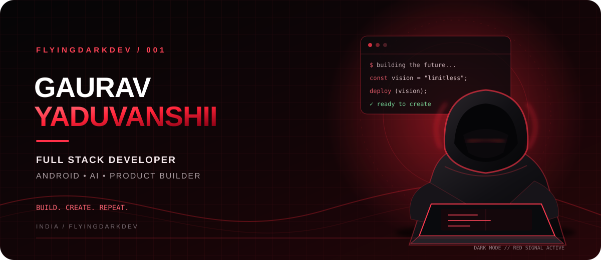
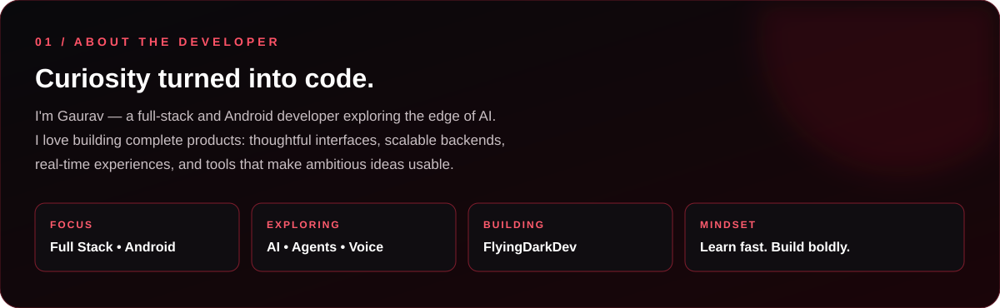
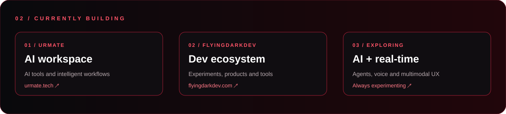

 

**`DEVELOPER`** &nbsp;•&nbsp; **`BUILDER`** &nbsp;•&nbsp; **`AI EXPLORER`**

---

## 🔴 Live GitHub Snapshot

  

  

 

> Live badges are fetched from GitHub / the contributions API. External badge and stats services may cache results briefly; they are not guaranteed to refresh instantly.

---

## 🧬 Tech Arsenal

**LANGUAGES & CORE**
 

**FRONTEND & BACKEND**
 

**MOBILE, DATABASE & INFRA**
 

---

## 🧪 Selected Work

- **Urmate** — AI platform and workspace · [urmate.tech](https://urmate.tech)
- **FlyingDarkDev** — Developer brand, experiments, and products · [flyingdarkdev.com](https://www.flyingdarkdev.com)

## ⚙️ What I'm Exploring

`LLM INTEGRATION` &nbsp; `AI AGENTS` &nbsp; `REAL-TIME VOICE`  
`MULTIMODAL UX` &nbsp; `FULL-STACK ARCHITECTURE` &nbsp; `FLUTTER`

---

## 📡 Find Me Online

  

