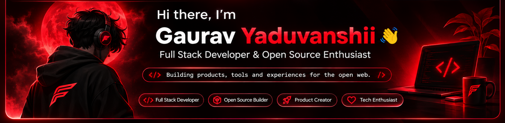
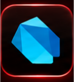
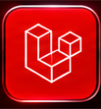
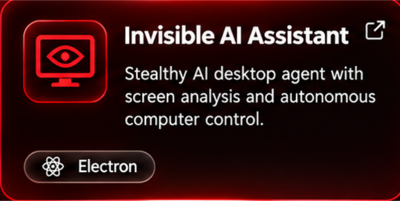
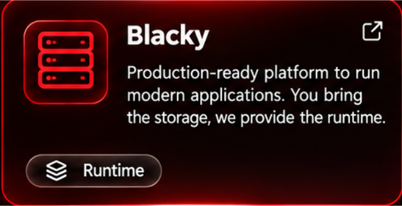
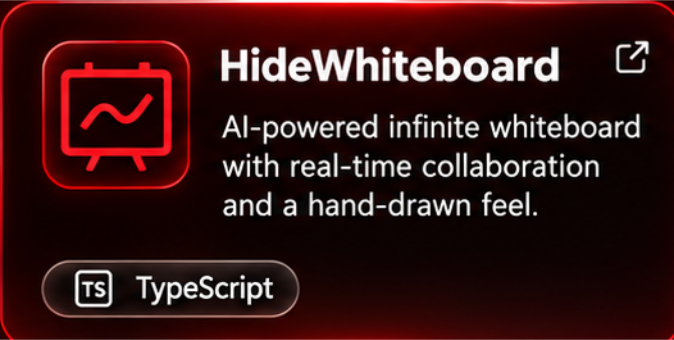
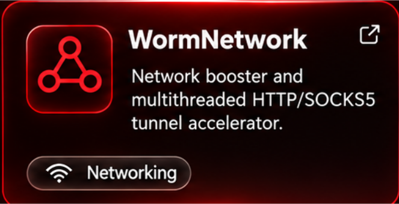
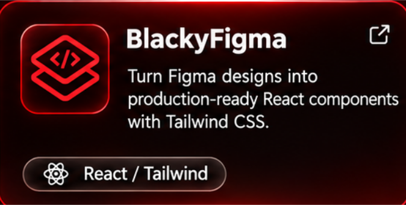
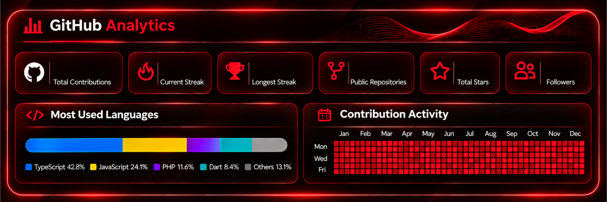

<!--
  Gaurav Kumar Yadav (@xgauravyaduvanshii) — GitHub profile README.
  This is Gaurav's own Figma design (frame 'Portfolio — linked', 2111 px wide),
  sliced into SVG pieces so every clickable rectangle he placed in Figma works
  as a real link. A single SVG  cannot carry working links on GitHub, so
  each clickable piece is its own slice wrapped in an <a> tag; plain pieces are
  unlinked. No text, heading, badge or section was added — the design is shown
  exactly as designed. Sections top to bottom: Banner, Urmate, Tech Stack,
  Featured Open Source Projects, GitHub Analytics, Connect With Me.
  Slices live in slices/ as standalone SVGs (cropped raster embedded as base64).
  portfolio-linked.svg is the full Figma export with <a> overlays — links work
  when that file is opened directly in a browser or on GitHub's file view.
-->

